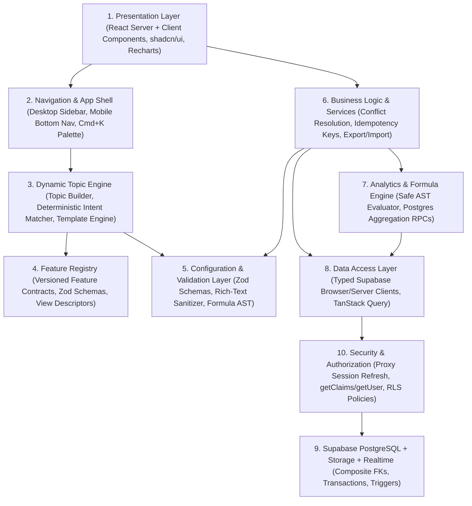

# System Architecture — NEXORA Personal Operating System

## 1. Architectural Philosophy

NEXORA is built as a **schema-driven modular monolith** using Next.js (App Router) and Supabase (PostgreSQL, Auth, Storage, Realtime). Instead of hardcoding domain-specific pages or spawning per-topic physical SQL tables, NEXORA pairs a **typed Feature Registry** (`src/engine/feature-registry/`) with a **normalized hybrid relational + validated JSONB schema** in PostgreSQL (`supabase/migrations/`).

Every topic behaves as an independent mini-application composed from versioned feature modules (`tasks`, `journal`, `activity_logs`, `time_tracking`, `custom_tables`, `calculators`, `goals`, `habits`, `calendar`, `analytics`, `attachments`).

## 2. Layered Architecture

## 3. Core Architectural Decisions & Tradeoffs

1. **Modular Monolith over Microservices**: Next.js App Router (Server Components + Route Handlers + Server Actions) directly integrates with Supabase via `@supabase/ssr` and PostgreSQL RPCs. This avoids operational overhead and optimizes latency and free-tier quotas.
2. **Hybrid Relational + Validated JSONB Schema**: Core entities (`topics`, `tasks`, `journal_entries`, `time_sessions`, `goals`, `habits`, `calculator_definitions`) remain strongly typed relational tables for fast indexing and SQL constraints, while `custom_records.data`, `topic_modules.config`, and `module_fields.options/validation_rules` use JSONB validated at application and SQL boundary.
3. **Deterministic Topic Discovery (Zero Paid LLM Dependency)**: Step 2 of the Topic Builder uses a deterministic multi-signal intent matcher (keyword/synonym scoring, category priors, template proximity, and conditional follow-up rules) with transparent confidence levels and a generic fallback builder for unrecognized topics.
4. **AST-Based Formula Parser (Zero `eval()`)**: The custom calculator engine tokenizes and parses expressions into a typed Abstract Syntax Tree (`number`, `identifier`, `unary`, `binary`, `call`, `conditional`), enforces an allowlist of safe mathematical functions, detects circular references, guards against division by zero / `Infinity` / `NaN`, and evaluates monetary quantities with scaled decimal precision.
5. **Atomic PostgreSQL RPCs for Multi-Entity Writes**: Topic creation (`create_topic_atomic`), topic duplication (`duplicate_topic_atomic`), topic archive/restore, timer transitions (`start_time_session`, `pause_time_session`, `stop_time_session`), and versioned updates execute inside short database transactions with idempotency tracking.
6. **Configurable Application Brand Name**: Stored per-user in `user_preferences.app_name` (default `NEXORA`), rendered dynamically across shell headers, page titles, and settings without requiring redeployment.
7. **Selective Realtime + Reconnection Refetch**: Client queries subscribe selectively to active topic/global change streams keyed by `user_id`, invalidate affected TanStack Query caches cleanly, and refetch authoritative data on reconnect or visibility recovery.

## 4. Data Flow Contracts

- **Authentication & SSR Guard**: `src/proxy.ts` invokes `@supabase/ssr` `supabase.auth.getClaims()` on protected routes to refresh tokens and redirect unauthenticated requests to `/login`. Server Components and API Route Handlers verify identity via `getClaims()` / `getUser()`.
- **Optimistic Concurrency Control (OCC)**: Mutable entities include `version integer`. Updates include `expected_version`; mismatches return HTTP `409 Conflict` with latest server state so the UI presents a reload/compare/resolve flow rather than overwriting newer edits.
- **Idempotency**: Mutating RPCs and API endpoints accept an `Idempotency-Key` header/parameter stored in `idempotency_records(user_id, operation, idempotency_key)` with a SHA-256 `request_hash`. Replays with matching hash return the original stored result; mismatched payloads fail with `422` / `409`.
- **Supabase Free-Tier Guardrails**:
  - Server-side pagination (`limit`/`offset` or keyset cursors) on all lists/tables.
  - Database-side aggregation via SQL RPCs (`get_global_dashboard_summary`, `get_topic_analytics_summary`) instead of downloading full tables.
  - Private Storage bucket (`nexora-attachments`) with 10 MB per-file ceiling and short-lived signed URLs.
