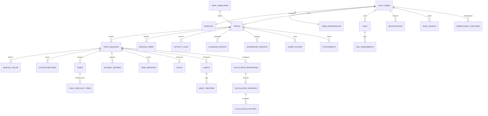

# Database Design — JournalX PostgreSQL Architecture

## 1. Design Principles

1. **UUID Primary Keys**: All domain tables use `uuid` (`gen_random_uuid()`) primary keys.
2. **Database-Level Cross-Topic & Cross-User Integrity**: Child tables carry `(topic_id, user_id)` or `(module_id, topic_id, user_id)` and reference parent composite unique constraints `UNIQUE (id, topic_id, user_id)`. This prevents cross-user or cross-topic foreign-key spoofing at the database layer.
3. **Mandatory Row-Level Security (RLS)**: Every table in `public` enables and forces RLS (`ALTER TABLE ... ENABLE ROW LEVEL SECURITY; ALTER TABLE ... FORCE ROW LEVEL SECURITY;`), using `TO authenticated` and `(select auth.uid()) = user_id` to cache the auth UID per statement.
4. **Precision Types**: `timestamptz` for all timestamps, `numeric(18,4)` / `numeric(12,2)` for scores/financials/targets, `text` instead of arbitrary `varchar(n)`.
5. **Indexed Foreign Keys & Query Paths**: Every FK column and RLS `user_id` column is indexed, supplemented by composite indexes (`(user_id, topic_id, status)`, `(user_id, occurred_at desc)`), partial unique indexes (`where deleted_at is null`, `where status = 'running'`), and GIN trigram/full-text indexes for search.

## 2. Entity Relationship Diagram

## 3. Core Tables & Integrity Rules

| Group | Tables | Key Constraints & Indexes |
|---|---|---|
| Identity & Settings | `profiles`, `user_preferences` | Auto-provisioned via `auth.users` trigger (`SECURITY DEFINER`, `search_path = ''`, explicit `new.id`), `version` OCC |
| Topic Engine | `topic_templates`, `topics`, `topic_modules`, `module_fields`, `module_views` | Partial unique `(user_id, slug) where deleted_at is null`; unique `(topic_id, module_key)`; unique `(module_id, field_key)`; composite `(id, topic_id, user_id)` keys |
| Operational Modules | `custom_records`, `tasks`, `task_checklist_items`, `journal_entries`, `activity_logs`, `time_sessions` | Composite FKs to `(module_id, topic_id, user_id)`; partial unique `(user_id) where status = 'running'` on `time_sessions`; `import_hash` partial unique on `custom_records` |
| Goals, Habits & Calendar | `goals`, `habits`, `habit_checkins`, `calendar_events` | Unique `(habit_id, checkin_date)` preventing duplicate daily check-ins; `ends_at >= starts_at` check on `calendar_events` |
| Calculators | `calculator_definitions`, `calculator_versions`, `calculation_history` | Immutable version snapshots `(calculator_id, version_number)` linked from `calculation_history` |
| Workspace & Governance | `dashboard_widgets`, `saved_filters`, `tags`, `tag_assignments`, `attachments`, `notifications`, `audit_events`, `idempotency_records` | Case-insensitive unique `(user_id, normalized_name)` on `tags`; storage size check `<= 10 MB`; unique `(user_id, operation, idempotency_key)` |

## 4. Storage Architecture

- Bucket: `nexora-attachments` (`public = false`, `file_size_limit = 10485760` bytes, curated safe MIME allowlist).
- Storage Path Convention: `{user_id}/{topic_id}/{entity_type}/{entity_id}/{uuid}-{safe_filename}`.
- `storage.objects` RLS policies allow `SELECT`, `INSERT`, `UPDATE`, `DELETE` exclusively `TO authenticated` where `bucket_id = 'nexora-attachments'` and `(storage.foldername(name))[1] = (select auth.uid())::text`.

## 5. Transactions, Locking & Concurrency Strategy

- **Short Transactions**: All RPCs validate inputs first, keep lock windows narrow, and enforce `statement_timeout`.
- **Optimistic Concurrency Control**: Update RPCs and API handlers include `AND version = p_expected_version`, returning `version = version + 1`. Zero affected rows triggers an existence check to distinguish `404 Not Found` from `409 Conflict`.
- **Idempotency Table**: `idempotency_records` prevents duplicate creates/imports on client retries with 24-hour TTL cleanup support.
- **Migration Strategy**: Sequential SQL migrations in `supabase/migrations/` paired with `supabase/seed.sql` for built-in system templates (`IELTS Preparation`, `Personal Finance`, `Learning & Engineering`, `Productivity`, `Custom Calculator`, `Blank`).
